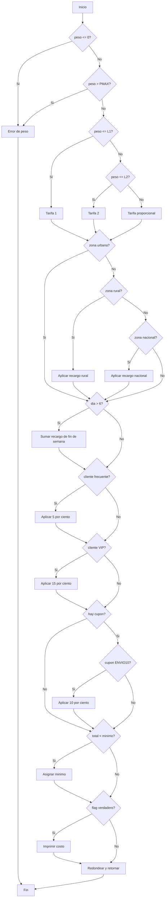
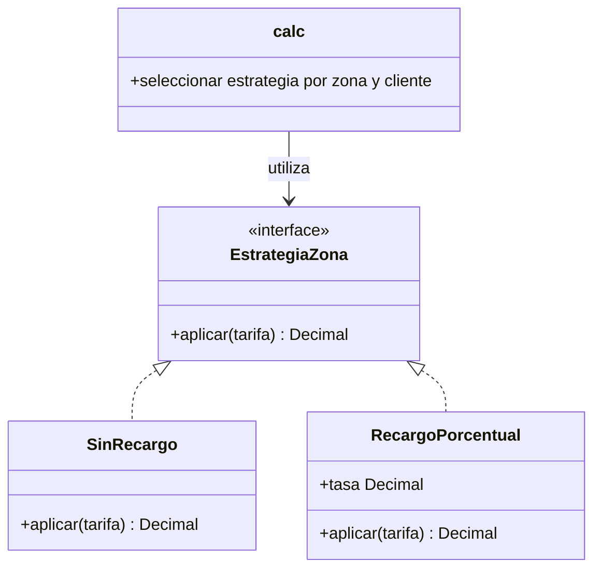

Parcial 3 — Ingenieria de Software I

Estudiante: Jhon Faber Mindiola Atencio
Codigo estudiantil: 0182410099


#### **Parte 1 — Requisitos y criterios de aceptación**


###### **1.1 Parametros personalizados**


|A|B|C|D|E|F|PMAX|L1|L2|RR|RN|V|S|CAMBIO|
| --- | --- | --- | --- | --- | --- | --- | --- | --- | --- | --- | --- | --- | --- |
|4|1|0|0|9|9|50 kg|3 kg|10 kg|15 %|40 %|15 %|$2.000|1|
###### **1.2 Especificacion del calculo del costo**


**R1**. El peso debe cumplir 0 < peso ≤ 50 kg. Si no, se lanza el error “peso invalido”.

**R2**. La zona debe ser urbana, rural o nacional. El dia debe estar entre 1 y 7. Si la zona o el dia no son validos, se lanza un error.

**R3**. Tarifa base:


* Tramo 1: como D = 0 es par, incluye el limite. Para peso ≤ 3 kg, la tarifa es $6.000.
* Tramo 2: para peso > 3 kg y peso ≤ 10 kg, la tarifa es $9.000.
* Para peso > 10 kg, la tarifa es $9.000 mas $800 por cada kilogramo por encima de 10 kg.


**R4**. Recargo por zona:


* Urbana: sin recargo.
* Rural: recargo del 15 %.
* Nacional: recargo del 40 %.


**R5**. Fin de semana: el sabado, dia 6, y el domingo, dia 7, se agrega un recargo de $2.000. Como E = 9 es impar, este recargo se aplica despues de los descuentos.

**R6**. Descuentos:


* Cliente frecuente: 5 %.
* Cliente VIP: 15 %.
* Cupon ENVIO10: 10 %.
* Como B = 1 es impar, si se combinan el descuento del cliente y el cupon, se aplican ambos en secuencia: primero el descuento del cliente y luego el cupon.


**R7**. Como F = 9 es impar, un cupon desconocido produce un error. El cupon es opcional.

**R8**. El costo final no puede ser menor que $5.000. El resultado se redondea al multiplo de $100 mas cercano. Si queda exactamente a mitad entre dos centenas, los $50 se redondean hacia arriba.


###### **1.3 Historias de usuario y criterios de aceptación**


**Historia de usuario 1: calcular la tarifa de un envió**


Como cliente de EnviaYa, quiero conocer el costo de mi envio segun su peso y destino, para saber cuanto debo pagar.

Criterios de aceptacion:


* Dado un peso mayor que 0 y menor o igual que 50 kg, cua		ndo se calcula el envio, entonces el sistema debe determinar la tarifa base usando los tramos definidos en R3.
* Dado un envio con zona urbana, rural o nacional, cuando se calcula el envio, entonces el sistema debe aplicar el recargo correspondiente definido en R4.
* Dado un peso igual o menor que 0, o mayor que 50 kg, cuando se calcula el envio, entonces el sistema debe lanzar el error “peso invalido”.


**Historia de usuario 2: aplicar descuentos y recargo de fin de semana**


Como cliente de EnviaYa, quiero que el sistema aplique correctamente mi descuento, mi cupon y el recargo de fin de semana, para recibir un total calculado con las reglas del negocio.

Criterios de aceptacion:


* Dado un cliente frecuente, cuando se calcula su envio, entonces se debe aplicar un descuento del 5 %.
* Dado un cliente VIP, cuando se calcula su envio, entonces se debe aplicar un descuento del 15 %.
* Dado un cupon ENVIO10 valido, cuando se calcula el envio, entonces se debe aplicar un descuento del 10 %.
* Dado un descuento de cliente y un cupon valido, cuando ambos estan presentes, entonces se deben aplicar ambos descuentos en secuencia: primero el descuento de cliente y luego el cupon.
* Dado un envio programado para sabado o domingo, cuando se calcula el costo, entonces se debe agregar un recargo de $2.000 despues de los descuentos.
* Dado un cupon desconocido, cuando se calcula el envio, entonces el sistema debe lanzar un error.


**Historia de usuario 3: validar los datos y entregar el costo final**


Como cliente de EnviaYa, quiero que el sistema valide los datos de mi envio y muestre un costo minimo correctamente redondeado.

Criterios de aceptacion:


* Dada una zona distinta de urbana, rural o nacional, cuando se calcula el envio, entonces el sistema debe lanzar un error.
* Dado un dia menor que 1 o mayor que 7, cuando se calcula el envio, entonces el sistema debe lanzar un error.
* Dado un costo calculado menor que $5.000, cuando se obtiene el total, entonces el sistema debe usar $5.000 como costo minimo.
* Dado un costo que debe redondearse, cuando se obtiene el resultado final, entonces el sistema debe redondearlo al multiplo de $100 mas cercano y redondear los $50 hacia arriba.


###### **1.4 Matriz de trazabilidad inicial**


|Requisito|Historia de usuario|Casos de prueba asociados|
| --- | --- | --- |
|R1|Historia de usuario 1|P01, P02, P03|
|R2|Historia de usuario 3|P10, P11, P12, P13, P16, P17|
|R3|Historia de usuario 1|P04, P05, P06, P07|
|R4|Historia de usuario 1|P10, P14, P15|
|R5|Historia de usuario 2|P16, P18, P25, P32|
|R6|Historia de usuario 2|P19, P20, P21, P22, P23, P32|
|R7|Historia de usuario 2|P24|
|R8|Historia de usuario 3|P07, P25, P26, P32|
#### **Parte 2 — Plan de pruebas**


###### **2.1 Alcance**


El plan verifica el calculo del costo de envio de EnvíaYa de acuerdo con los requisitos R1 a R8 de la Parte 1. Se probaran el peso, la zona, el dia, el tipo de cliente, el cupon, la tarifa base, los recargos, los descuentos, el costo minimo y el redondeo.


En esta parte, las pruebas se ejecutaran primero contra el codigo heredado para registrar los defectos observados. Despues de corregir el codigo, se repetiran los mismos casos como pruebas de regresion.


###### **2.2 Niveles de prueba**


| Nivel | Aplicacion en este proyecto |
| --- | --- |
| Unidad | Probar la funcion de calculo con entradas individuales y comprobar el resultado o error esperado. |
| Integracion | Comprobar que la funcion de calculo usa correctamente la configuracion personalizada de Jhon y las reglas de zona, cliente   y cupon. |
| Sistema | Probar el flujo completo de ingreso de peso, zona, cliente, dia y cupon hasta obtener el costo final. |
| Aceptacion | Comprobar que los resultados cumplen las reglas R1 a R8 de la especificacion personalizada. |
###### **2.3 Estrategia de pruebas**


Se usaran particiones de equivalencia, valores limite, tablas de decision y pruebas de caja blanca.


Se probaran entradas validas e invalidas para cada dato. Para el peso se revisaran los limites 0, L1 = 3 kg, L2 = 10 kg y PMAX = 50 kg. Tambien se probaran las combinaciones de cliente, cupon y fin de semana que afectan el orden de los descuentos y recargos.


Los resultados esperados se calcularan manualmente antes de ejecutar los casos. La suite se ejecutara contra el codigo heredado y, despues de corregir los defectos, contra la version refactorizada.


###### 2.4 Ambiente y herramientas


* Sistema operativo: Windows.
* Lenguaje: Python.
* Framework de pruebas: pytest.
* Medicion de cobertura: pytest-cov.
* Control de versiones: Git y GitHub.
* Archivo bajo prueba: envios.py.
* Archivo con el codigo heredado: se conservara separado para comparar su comportamiento.


###### 2.5 Roles


| Rol | Responsabilidad |
| --- | --- |
| Estudiante y responsable de pruebas | Jhon Faber Mindiola Atencio: define los casos, calcula los resultados esperados, automatiza las pruebas, registra defectos y corrige el codigo. |
| Revisor de requisitos | Verifica que los casos y resultados correspondan a la especificacion personalizada. |
| Usuario de aceptacion | Comprueba que el costo final siga las reglas de negocio de EnvíaYa. |
###### 2.6 Riesgos y mitigaciones


| Riesgo | Mitigacion |
| --- | --- |
| Usar parametros de otro estudiante | Verificar que el informe y CONFIG usen el codigo 0182410099. |
| Calcular mal el orden de recargos y descuentos | Aplicar el orden definido por B = 1 y E = 9, y mostrar calculos manuales. |
| No probar exactamente los limites de peso | Incluir casos en 0, 3, 10 y 50 kg, ademas de valores inmediatamente inferiores o superiores. |
| Corregir el codigo antes de registrar los defectos heredados | Ejecutar primero las pruebas contra la version heredada y guardar sus resultados. |
| Cambiar una regla al refactorizar | Ejecutar de nuevo la misma suite como regresion despues de cada cambio. |
| No tener evidencia de pruebas o historial Git | Guardar capturas y hacer commits al completar cada avance real. |
###### **2.7 Criterios de entrada**


* La especificacion R1 a R8 esta escrita y personalizada para Jhon.
* Los parametros de CONFIG corresponden al codigo 0182410099.
* Los casos de prueba tienen entradas y resultados esperados calculados.
* El codigo heredado esta disponible para la primera ejecucion.


###### **2.8 Criterios de salida**


* Todos los casos planificados fueron ejecutados contra el codigo heredado.
* Los defectos observados quedaron registrados con pasos para reproducirlos.
* Despues de las correcciones, se repitieron los mismos casos.
* Los resultados finales y la cobertura quedaron documentados.
* Se conservaron las evidencias necesarias para el informe y la sustentacion.


#### **Parte 3 — Diseño de casos de caja negra**


###### **3.1 Particiones de equivalencia**


Una particion de equivalencia agrupa entradas que deberian recibir el mismo tratamiento. Se probaran valores de cada grupo para verificar que el sistema responda segun la especificacion R1–R8.


| Entrada | Particiones validas | Particiones invalidas o especiales |
| --- | --- | --- |
| Peso | 0 < peso ≤ 3 kg; 3 kg < peso ≤ 10 kg; 10 kg < peso ≤ 50 kg | Peso ≤ 0 y peso > 50 kg. Debe producirse el error de peso indicado en R1. |
| Zona | urbana, rural y nacional | Cualquier valor distinto de esas tres zonas. R2 exige un error. |
| Cliente | normal, frecuente y vip | Un tipo distinto de esos tres queda fuera del dominio descrito. El enunciado no define que resultado debe producir; se registrara esta ambiguedad y no se asignara un resultado esperado como si fuera una regla del profesor. |
| Dia | Dias habiles del 1 al 5; sabado 6; domingo 7 | Valores menores que 1 y mayores que 7. R2 exige un error. |
| Cupon | Sin cupon; cupon ENVIO10 | Cualquier cupon desconocido. Como F = 9 es impar, R7 exige un error. |
###### **3.2 Valores limite del peso**


El valor L1 es 3 kg y se incluye en el primer tramo porque D = 0 es par. L2 es 10 kg y se incluye en el segundo tramo. PMAX es 50 kg y tambien se acepta.


| Limite | Por debajo | En el limite | Por encima |
| --- | --- | --- | --- |
| 0 kg | -0,01 kg — P02 | 0 kg — P01 | 0,01 kg — P08 |
| L1 = 3 kg | 2,99 kg — P28 | 3 kg — P04 | 3,01 kg — P05 |
| L2 = 10 kg | 9,99 kg — P29 | 10 kg — P06 | 10,01 kg — P30 |
| PMAX = 50 kg | 49,99 kg — P31 | 50 kg — P09 | 50,01 kg — P03 |
P30 permite revisar el peso inmediatamente superior a L2. Su incremento de tarifa base es de $8, pero al redondear a la centena mas cercana el resultado urbano sigue siendo $9.000. Por eso tambien se incluye P07, cuyo peso permite observar el cobro proporcional en el resultado final.


###### **3.3 Tabla de decision: cliente, cupon y fin de semana**


A representa la tarifa base despues de aplicar el recargo de zona. Como B = 1 es impar, los descuentos de cliente y cupon se aplican ambos y en secuencia: primero el descuento del cliente y luego el cupon. Como E = 9 es impar, el recargo de fin de semana se suma despues de los descuentos.


| Cliente | Cupon | Dias 1–5 | Dias 6–7 |
| --- | --- | --- | --- |
| Normal | Ausente | A | A + $2.000 |
| Normal | ENVIO10 | A × 0,90 | A × 0,90 + $2.000 |
| Normal | Desconocido | Error | Error |
| Frecuente | Ausente | A × 0,95 | A × 0,95 + $2.000 |
| Frecuente | ENVIO10 | A × 0,95 × 0,90 | A × 0,95 × 0,90 + $2.000 |
| Frecuente | Desconocido | Error | Error |
| VIP | Ausente | A × 0,85 | A × 0,85 + $2.000 |
| VIP | ENVIO10 | A × 0,85 × 0,90 | A × 0,85 × 0,90 + $2.000 |
| VIP | Desconocido | Error | Error |
Despues de aplicar la regla correspondiente, el costo minimo es $5.000 y el resultado se redondea al multiplo de $100 mas cercano. Los $50 se redondean hacia arriba.


###### **3.4 Matriz de casos de prueba**

Las entradas se escriben en este orden: peso; zona; cliente; dia; cupon. La matriz muestra resultados esperados concisos; los calculos completos aparecen en la seccion 3.5.

| ID | Req. | Entradas | Resultado esperado | Tecnica |
| --- | --- | --- | --- | --- |
| P01 | R1 | 0 kg; urbana; normal; d3; sin cupon | Error: peso invalido (R1 indica "peso inválido") | Limite |
| P02 | R1 | -0,01 kg; urbana; normal; d3; sin cupon | Error de peso | Limite |
| P03 | R1 | 50,01 kg; urbana; normal; d3; sin cupon | Error de peso | Limite |
| P04 | R3 | 3 kg; urbana; normal; d5; sin cupon | $6.000 | Limite L1 |
| P05 | R3 | 3,01 kg; urbana; normal; d5; sin cupon | $9.000 | Limite L1 |
| P06 | R3 | 10 kg; urbana; normal; d5; sin cupon | $9.000 | Limite L2 |
| P07 | R3, R8 | 11,3125 kg; urbana; normal; d5; sin cupon | Base $10.050; final $10.100 | Proporcional y redondeo |
| P08 | R1, R3 | 0,01 kg; urbana; normal; d5; sin cupon | $6.000 | Particion valida |
| P09 | R1, R3 | 50 kg; urbana; normal; d5; sin cupon | $41.000 | Limite PMAX |
| P10 | R2 | 2 kg; costera; normal; d3; sin cupon | Error de zona | Particion invalida |
| P11 | R2 | 2 kg; rural; normal; d0; sin cupon | Error de dia | Limite |
| P12 | R2 | 2 kg; rural; normal; d8; sin cupon | Error de dia | Limite |
| P13 | R2 | 2 kg; urbana; normal; d-1; sin cupon | Error de dia | Particion invalida |
| P14 | R4 | 4 kg; rural; normal; d5; sin cupon | $10.350 -> $10.400 | Zona rural |
| P15 | R4 | 4 kg; nacional; normal; d5; sin cupon | $12.600 | Zona nacional |
| P16 | R2, R5 | 4 kg; urbana; normal; d5; sin cupon | $9.000 | Dia habil |
| P17 | R2, R5 | 4 kg; urbana; normal; d7; sin cupon | $11.000 | Domingo |
| P18 | R5 | 4 kg; urbana; normal; d6; sin cupon | $11.000 | Sabado |
| P19 | R6 | 4 kg; urbana; frecuente; d5; sin cupon | $8.550 -> $8.600 | Cliente frecuente |
| P20 | R6 | 4 kg; urbana; vip; d5; sin cupon | $7.650 -> $7.700 | Cliente VIP |
| P21 | R6 | 4 kg; urbana; normal; d5; ENVIO10 | $8.100 | Cupon valido |
| P22 | R6 | 4 kg; urbana; vip; d5; ENVIO10 | $6.885 -> $6.900 | Cliente y cupon |
| P23 | R6 | 4 kg; urbana; frecuente; d5; ENVIO10 | $7.695 -> $7.700 | Cliente y cupon |
| P24 | R7 | 4 kg; urbana; normal; d5; OTRO | Error por cupon desconocido | Cupon desconocido |
| P25 | R5, R8 | 4 kg; urbana; vip; d6; sin cupon | $9.650 -> $9.700 | Fin de semana y redondeo |
| P26 | R6, R8 | 2 kg; urbana; vip; d5; ENVIO10 | $4.590 -> minimo $5.000 | Minimo |
| P27 | R4–R8 | 4 kg; rural; vip; d6; ENVIO10 | $9.917,75 -> $9.900 | Combinacion de reglas |
| P28 | R3 | 2,99 kg; urbana; normal; d5; sin cupon | $6.000 | Limite L1 |
| P29 | R3 | 9,99 kg; urbana; normal; d5; sin cupon | $9.000 | Limite L2 |
| P30 | R3, R8 | 10,01 kg; urbana; normal; d5; sin cupon | Base $9.008; final $9.000 | Limite L2 |
| P31 | R3, R8 | 49,99 kg; urbana; normal; d5; sin cupon | Base $40.992; final $41.000 | Limite PMAX |
| P32 | R5, R6, R8 | 4 kg; urbana; vip; d7; sin cupon | Base $9.000; VIP $7.650; mas $2.000 = $9.650; final $9.700 | Orden del recargo y descuento |
Caso P32

La tarifa base es $9.000. Descuento VIP: $9.000 × 0,85 = $7.650. El dia 7 es domingo, por lo que se agregan $2.000 despues del descuento: $9.650. Los $50 se redondean hacia arriba. Resultado esperado: $9.700.

###### **3.5 Calculos detallados de resultados esperados**


**Caso P07**


El peso es 11,3125 kg, por lo que supera L2 = 10 kg. El exceso es 11,3125 − 10 = 1,3125 kg.


Tarifa base = $9.000 + (1,3125 × $800) = $10.050.


La zona es urbana, no hay descuentos ni recargo de fin de semana. El costo es mayor que el minimo de $5.000. Como termina exactamente en $50, se redondea hacia arriba.


Resultado esperado: $10.100.


**Caso P14**


El peso de 4 kg pertenece al segundo tramo, asi que la tarifa base es $9.000.


Recargo rural = $9.000 × 0,15 = $1.350.


Subtotal = $9.000 + $1.350 = $10.350.


El valor esta a mitad entre $10.300 y $10.400; los $50 se redondean hacia arriba.


Resultado esperado: $10.400.


**Caso P22**


El peso de 4 kg pertenece al segundo tramo. La tarifa base urbana es $9.000.


Descuento VIP = $9.000 × 0,85 = $7.650.


Cupon ENVIO10, aplicado despues del descuento VIP = $7.650 × 0,90 = $6.885.


No hay recargo de fin de semana y el costo es mayor que el minimo.


Resultado esperado redondeado: $6.900.


**Caso P25**


La tarifa base para 4 kg en zona urbana es $9.000.


Descuento VIP = $9.000 × 0,85 = $7.650.


El dia 6 es sabado. Como E = 9 es impar, el recargo de $2.000 se agrega despues de los descuentos.


Subtotal = $7.650 + $2.000 = $9.650.


Los $50 se redondean hacia arriba.


Resultado esperado: $9.700.


**Caso P26**


El peso de 2 kg pertenece al primer tramo, cuya tarifa es $6.000.


Descuento VIP = $6.000 × 0,85 = $5.100.


Cupon ENVIO10, aplicado despues del descuento VIP = $5.100 × 0,90 = $4.590.


El resultado es menor que el costo minimo.


Resultado esperado: $5.000.


**Caso P27**


El peso de 4 kg tiene tarifa base de $9.000.


Recargo rural = $9.000 × 1,15 = $10.350.


Descuento VIP = $10.350 × 0,85 = $8.797,50.


Cupon ENVIO10 = $8.797,50 × 0,90 = $7.917,75.


Como es sabado y E = 9 es impar, se agregan $2.000 despues de los descuentos.


Subtotal = $7.917,75 + $2.000 = $9.917,75.


El multiplo de $100 mas cercano es $9.900.


Resultado esperado: $9.900.


###### **3.6 Observaciones de la especificacion**


El enunciado no define que debe ocurrir si el tipo de cliente no es normal, frecuente o vip. En esta matriz no se asigna un resultado esperado para ese caso, porque no se debe inventar una regla que el profesor no especifico.


Los resultados de esta matriz se calcularon segun R1–R8 para Jhon. Al ejecutar los mismos casos contra el codigo heredado, algunos fallaran; esos resultados obtenidos se registraran despues en la Parte 5 como defectos.


#### **Parte 4 — Diseño de casos de caja blanca**

##### **4.1 Grafo de flujo del codigo heredado**

El grafo representa las decisiones de `calc` en `envios_heredado.py`. La ruta comienza validando el peso, selecciona un tramo, procesa la zona, el dia, el cliente, el cupon, el minimo y la opcion de impresion.



##### **4.2 Complejidad ciclomática**

El grafo tiene 29 nodos y 42 aristas. Se cuentan 14 predicados binarios: las dos condiciones de validación del peso (`p <= 0` y `p > PMAX`), los dos límites de tarifa, las tres comparaciones de zona, el día, los dos tipos de cliente, la presencia y validez del cupón, el mínimo y `flag`.

La complejidad se comprueba de tres maneras:

1. `V(G) = E − N + 2 = 42 − 29 + 2 = 15`.
2. `V(G) = P + 1 = 14 + 1 = 15`.
3. El grafo tiene 15 regiones, por lo que `V(G) = 15`.

Las tres medidas coinciden. Por tanto, se identifican 15 caminos independientes para el método heredado.

##### **4.3 Caminos independientes**

La siguiente base identifica el camino de referencia y las alternativas que ejercitan las salidas de las decisiones del grafo. WB01–WB15 son los recorridos ejecutados contra `envios_heredado.py`; las diferencias entre esperado y observado se conservaron como defectos.

| Camino | Recorrido que lo distingue | Caso asociado |
| --- | --- | --- |
| C01 | Peso válido, primer tramo, zona urbana, día hábil, cliente normal, sin cupón, sobre el mínimo, `flag=False` | WB01 |
| C02 | Peso igual a 0: salida de error por límite inferior | WB02 |
| C03 | Peso mayor que PMAX: salida de error por límite superior | WB03 |
| C04 | Peso en el segundo tramo | WB04 |
| C05 | Peso superior a L2: tarifa proporcional | WB05 |
| C06 | Selección de zona rural | WB06 |
| C07 | Selección de zona nacional | WB07 |
| C08 | Zona fuera del catálogo: ninguna rama de zona coincide | WB08 |
| C09 | Día de fin de semana: se suma recargo | WB09 |
| C10 | Cliente frecuente: se aplica su descuento | WB10 |
| C11 | Cliente VIP: se aplica su descuento | WB11 |
| C12 | Cupón presente pero desconocido: rama de cupón no válido | WB12 |
| C13 | Cupón ENVIO10: rama de cupón válido | WB13 |
| C14 | El subtotal cae por debajo del mínimo | WB14 |
| C15 | `flag=True`: se ejecuta la impresión de diagnóstico | WB15 |

La complejidad y la tabla documentan los caminos y sus casos; no se interpreta el 100 % de cobertura como prueba de que la lógica sea correcta.

| ID | Entrada o rama principal | Esperado | Observado en heredado |
| --- | --- | --- | --- |
| WB01 | Peso primer tramo, urbana, normal, dia habil | $6.000 | $6.000 |
| WB02 | Peso 0 kg | Error de peso | ValueError: peso invalido |
| WB03 | Peso mayor que PMAX | Error de peso | ValueError: peso invalido |
| WB04 | Peso del segundo tramo | $9.000 | $9.000 |
| WB05 | Peso mayor que L2 | $9.000 tras redondear | $9.000 |
| WB06 | Zona rural | $6.900 | $6.900 |
| WB07 | Zona nacional | $8.400 | $8.400 |
| WB08 | Zona fuera del catalogo | Error de zona | $6.000; no genera error |
| WB09 | Domingo sin descuento | $8.000 | $8.000 |
| WB10 | Cliente frecuente | $5.700 | $5.700 |
| WB11 | Cliente VIP | $5.100 | $5.100 |
| WB12 | Cupon desconocido | Error de cupon | $6.000; ignora el cupon |
| WB13 | Cupon ENVIO10 | $5.400 | $5.400 |
| WB14 | Descuentos dejan un valor menor al minimo | $5.000 | $5.000 |
| WB15 | Rama `flag=True` | Retorna $6.000 e imprime el diagnostico | Retorna $6.000 e imprime `costo: 6000` |

##### **4.4 Cobertura de sentencias y ramas**

Al ejecutar juntos los 32 casos de caja negra y los 15 recorridos de caja blanca sobre la version heredada, Coverage.py registro 29 de 29 sentencias y 26 de 26 ramas: 100 % en ambas medidas. Esta cobertura indica que el codigo fue recorrido; no significa que los resultados cumplan los requisitos. La ejecucion tuvo 21 casos fallidos.

#### **Parte 5 — Automatizacion, ejecucion y defectos**

##### **5.1 Suite y ambiente de ejecucion**

La suite automatizada contiene 32 casos de caja negra (`registro_heredado.py`) y 15 recorridos de caja blanca (`caja_blanca_heredado.py`). El ambiente utilizado fue Windows, Python 3.15.2, pytest 9.2.0, pytest-cov 7.1.0 y Coverage.py 7.17.2. El comando de ejecucion conjunta fue:

```powershell
.\.venv\Scripts\python.exe -m pytest pruebas/registro_heredado.py pruebas/caja_blanca_heredado.py --cov=envios_heredado --cov-branch --cov-report=term-missing -q
```

##### **5.2 Registro de defectos del codigo heredado**

Los niveles se asignan por el efecto del fallo: **Alta** cuando se acepta una entrada que debía rechazarse o se cobra una tarifa de negocio incorrecta; **Media** cuando el total es incorrecto en una condición específica; **Baja** cuando solo difiere el texto del error. P1 requiere corregir antes de liberar; P2 afecta resultados de casos concretos; P3 tiene impacto visual o de mensaje limitado.

| ID | Requisito | Reproducción | Resultado esperado | Observado en heredado | Severidad / prioridad y motivo |
| --- | --- | --- | --- | --- | --- |
| DEF-01 | R1 | P01: `calc(0, "urbana", "normal", 3)` | `ValueError("peso inválido")` | `ValueError("peso invalido")`, sin tilde | Baja / P3: el rechazo ocurre, pero el mensaje no coincide literalmente con R1. |
| DEF-02 | R2 | P10: `calc(2, "costera", "normal", 3)` | Error por zona inválida | Devuelve `$6.000` | Alta / P1: zona no autorizada produce un cobro. |
| DEF-03 | R2 | P11: `calc(2, "rural", "normal", 0)` | Error por día inválido | Devuelve una tarifa | Alta / P1: acepta fechas fuera del rango permitido. |
| DEF-04 | R5 | P18: `calc(4, "urbana", "normal", 6)` | `$11.000` | `$9.000` | Alta / P1: omite el recargo obligatorio del sábado. |
| DEF-05 | R5, R6 | P32: `calc(4, "urbana", "vip", 7)` | `$9.700` | `$9.300` | Media / P2: aplica el recargo antes del descuento y trunca el total. |
| DEF-06 | R8 | P14: `calc(4, "rural", "normal", 5)` | `$10.400` | `$10.300` | Media / P2: el truncamiento altera el precio final. |
| DEF-07 | R7 | P24: `calc(4, "urbana", "normal", 5, "OTRO")` | Error por cupón desconocido | Devuelve `$9.000` | Alta / P1: acepta un cupón inválido en vez de rechazar la solicitud. |

##### **5.3 Metricas de la ejecucion inicial**

| Metrica | Resultado | Base de calculo |
| --- | --- | --- |
| Casos ejecutados | 47 | 32 de caja negra + 15 de caja blanca |
| Casos aprobados | 26 (55,32 %) | 26 / 47 × 100 |
| Casos fallidos | 21 (44,68 %) | Resultados distintos de la especificacion |
| Defectos unicos registrados | 7 | Causas distintas agrupadas por requisito |
| Defectos de severidad alta / media / baja | 4 / 2 / 1 | Clasificación de DEF-01 a DEF-07 |
| LOC de `envios_heredado.py` | 37 | Líneas no vacías ni comentarios, con el mismo criterio para todos los módulos |
| Densidad de defectos | 18,92 por 100 LOC | 7 defectos / 37 LOC × 100 |
| Cobertura de sentencias | 100 % (29/29) | Version heredada, ejecucion conjunta |
| Cobertura de ramas | 100 % (26/26) | Version heredada, ejecucion conjunta |

Los fallos del codigo heredado quedaron reproducidos antes de la correccion. El 100 % de cobertura no contradice los fallos: una prueba puede recorrer una rama y comprobar que el resultado de esa rama es incorrecto.

#### **Parte 6 — Mantenimiento y refactorización**

##### **6.1 Malos olores y deuda técnica del código heredado**

Los números de línea corresponden a `envios_heredado.py` en la etiqueta `v1.0.0`.

| Mal olor técnico | Evidencia y líneas | Deuda técnica |
| --- | --- | --- |
| Long Method | `calc`, líneas 12–50 | Una función concentra validación, precio, recargos, descuentos, mínimo, impresión y redondeo. |
| Long Parameter List | Firma de `calc`, línea 12: seis parámetros | Las llamadas son fáciles de confundir y la función recibe datos de varias responsabilidades. |
| Cryptic Names | `p`, `z`, `c`, `d`, `cup`, `t`, líneas 12–50 | El lector debe inferir qué representa cada variable. |
| Magic Numbers | Tarifas y límites, líneas 17–21, 26, 28, 35, 42, 45 y 50 | Los valores de negocio quedan dispersos y son difíciles de cambiar de forma segura. |
| Flag Argument / función de diagnóstico acoplada | `flag` en línea 12 y `if flag`/`print` en líneas 47–48 | Una opción cambia la salida secundaria y mezcla cálculo con presentación. |
| Primitive Obsession / uso de `float` para dinero | Tasas y operaciones de importe en líneas 25–28, 35, 38 y 42 | La aritmética binaria puede representar importes decimales con aproximación y afectar el redondeo. |

##### **6.2 Cambios realizados y tipo de mantenimiento**

| Cambio | Tipo de mantenimiento | Motivo |
| --- | --- | --- |
| Validar peso, zona, día y cupón | Correctivo | Corregir DEF-01, DEF-02, DEF-03 y DEF-07 |
| Aplicar el recargo después de descuentos y también el sábado | Correctivo | Corregir DEF-04 y DEF-05 |
| Redondear con `Decimal` y `ROUND_HALF_UP` | Correctivo | Corregir DEF-06 sin perder precisión decimal |
| Extraer validación, tarifa base, selección de zona y total | Perfectivo | Separar responsabilidades para facilitar lectura y cambio |
| Introducir el patrón Strategy para la zona | Perfectivo | Seleccionar una política de zona sin acumular condicionales en `calc` |
| Centralizar las reglas en `CONFIG` | Preventivo | Reducir la posibilidad de valores inconsistentes |

##### **6.3 Patrón Strategy para los recargos de zona**

`EstrategiaZona` define la operación `aplicar`. `SinRecargo` conserva el importe urbano y permite representar la exención empresarial. `RecargoPorcentual` aplica la tasa rural o nacional. `ESTRATEGIAS_ZONA` relaciona cada zona válida con su estrategia. La función `calc` selecciona la estrategia adecuada y mantiene el resto del cálculo en el mismo orden de R1–R8.



##### **6.4 Regresión y comparación de métricas**

La versión heredada se ejecutó con 47 casos: 26 aprobados y 21 fallidos. La versión final pasó 37 de 37 pruebas. La comparación se limita a la función pública `calc` para complejidad y a los módulos de cálculo para LOC; la cobertura corresponde a cada módulo medido por Coverage.py.

| Métrica | Heredado | Refactorizado y cambio empresarial | Interpretación |
| --- | --- | --- | --- |
| Complejidad ciclomática de `calc` | 15 | 3 | El método principal pasó de 14 predicados a dos decisiones; la lógica extraída se mide en funciones auxiliares. |
| LOC del módulo (no vacías ni comentarios) | 37 | 86 | El tamaño aumentó al extraer funciones, tipos y estrategias; la separación reduce responsabilidades por función. |
| Cobertura de sentencias | 29/29 (100 %) | 55/55 (100 %) | Ambas versiones recorrieron todas las sentencias medidas. |
| Cobertura de ramas | 26/26 (100 %) | 18/18 (100 %) | Se cubrieron las alternativas medidas de cada versión; una cobertura completa no demuestra por sí sola corrección. |
| Resultado de pruebas | 26/47 aprobadas; 21 fallidas | 37/37 aprobadas | Los defectos registrados se reprodujeron primero y la regresión final pasó. |

#### **Parte 7 — Control de versiones y publicación**

##### **7.1 Versiones, ramas e integración**

| Referencia | Propósito |
| --- | --- |
| `v1.0.0` (`f22e2ba`) | Identifica el código heredado personalizado, conservado en `envios_heredado.py` |
| `v2.0.0` (`14ad270`) | Identifica la versión corregida de R1–R8 antes de CAMBIO=1 |
| `fix/DEF-01` a `fix/DEF-07` | Ramas requeridas para los siete defectos registrados |
| `refactor/estrategia` | Rama requerida para la refactorizacion con Strategy |
| `test/suite` | Rama requerida para la suite automatizada |
| `feature/cambio-empresarial` | Rama de trabajo para la solicitud empresarial |
| `v2.1.0` | Versión menor que incorpora CAMBIO=1 sin cambiar la firma pública `calc(p, z, c, d, cup=None)` |

La implementacion R1-R8 y las pruebas quedaron consolidadas en `581933d`; por eso las ramas `fix/DEF-*`, `refactor/estrategia` y `test/suite` apuntan a ese commit, que ya forma parte de `main`. No se reescribio el historial para simular siete commits de correccion separados. La solicitud empresarial si conserva pruebas primero (`8db9081`) y luego codigo (`3eef8c9`), integrada mediante el merge `991a6c5`.

La etiqueta `v2.0.0` es mayor porque la refactorización elimina el parámetro público `flag` de la función heredada, lo que rompe compatibilidad con llamadas que lo usaban. `v2.1.0` es menor porque añade el tipo de cliente empresarial sin cambiar la firma ni las llamadas existentes. Las ramas por defecto y las etiquetas están publicadas; las ramas de defectos son referencias al cambio consolidado, no siete integraciones separadas.

##### **7.2 Changelog y publicación**

Los cambios resumidos por versión están en `CHANGELOG.md`, con fecha y categorías `Added`, `Changed` y `Fixed`, siguiendo Keep a Changelog. `v1.0.0` conserva la línea base, `v2.0.0` incorpora las correcciones y refactorización R1–R8, y `v2.1.0` agrega la regla empresarial. Las instrucciones para repetir las pruebas y ver el historial son:

```powershell
uv pip install --python .venv\Scripts\python.exe -r requirements.txt
.\.venv\Scripts\python.exe -m pytest --cov=envios --cov-branch --cov-report=term-missing -q
git log --oneline --graph --all
```

La salida de `git log --oneline --graph --all` se conserva como evidencia del historial integrado.

#### **Parte 8 — Solicitud de cambio y análisis de impacto**

##### **8.1 Solicitud personalizada CAMBIO=1**

La selección se obtiene de `(A + F) mod 3 = (4 + 9) mod 3 = 1`. Para el cliente `empresarial` se aplica un descuento del 12 %. Si su peso es estrictamente mayor que L2 = 10 kg, no se aplica recargo de zona. Con peso igual a 10 kg, el recargo de zona sí se aplica. Se conservan las validaciones, el orden del cupón, el recargo de fin de semana, el mínimo y el redondeo de R1–R8.

##### **8.2 Impacto sobre requisitos y pruebas**

| Elemento | Impacto | Verificación |
| --- | --- | --- |
| R4, recargo de zona | Empresarial con peso > 10 kg queda exento del recargo rural o nacional | SC-03 y SC-04 |
| R6, descuento de cliente | Se añade descuento empresarial del 12 % | SC-01 a SC-04 |
| R5 y R8 | El recargo de fin de semana sigue después de descuentos y el total usa el redondeo existente | SC-04 |
| Compatibilidad | Se mantiene la firma `calc(p, z, c, d, cup=None)` y el comportamiento de los clientes anteriores | Regresión de 32 casos y suite completa |

##### **8.3 Cálculos del cambio**

| Caso | Entradas | Cálculo esperado | Resultado |
| --- | --- | --- | --- |
| SC-01 | 4 kg, rural, empresarial, día 5 | $9.000 × 1,15 × 0,88 = $9.108 | $9.100 |
| SC-02 | 10 kg, rural, empresarial, día 5 | El peso igual a L2 conserva recargo: $9.000 × 1,15 × 0,88 = $9.108 | $9.100 |
| SC-03 | 10,01 kg, rural, empresarial, día 5 | Base $9.008; exención de zona; $9.008 × 0,88 = $7.927,04 | $7.900 |
| SC-04 | 11 kg, nacional, empresarial, domingo, ENVIO10 | Base $9.800; × 0,88 × 0,90 + $2.000 = $9.761,60 | $9.800 |

Las cuatro pruebas SC-01 a SC-04 y los 33 casos anteriores aprobaron: 37 de 37. La cobertura final fue 100 % de sentencias y ramas. El caso adicional de peso no numérico comprueba que la entrada inválida se convierta en `ValueError`.

##### **8.4 Tipo de mantenimiento**

La solicitud empresarial es **mantenimiento adaptativo**: el sistema se ajusta a una nueva regla del negocio y a un nuevo tipo de cliente. La incorporación de pruebas y del mapa de descuentos también incluye trabajo perfectivo porque mantiene la lógica más fácil de extender; el comportamiento empresarial se considera validado por SC-01 a SC-04 y la regresión completa.


